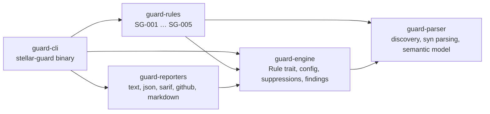
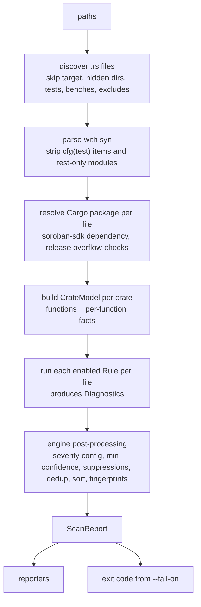

# Architecture

stellar-guard is a Cargo workspace of five crates with a strict one-way dependency graph:

## Pipeline

### guard-parser

* `discover` — walks each path (sorted, deterministic), skipping `target/`, `node_modules/`, hidden
  directories, and by default `tests/`, `benches/` and `test_snapshots/`. User globs are matched
  relative to the scan root.
* `project` — reads and parses files with `syn` (`span-locations` gives line/column). Unless
  `include-tests` is set, items annotated `#[cfg(test)]` / `#[test]` are removed, and out-of-line
  modules declared under `#[cfg(test)] mod test;` are dropped. Files that fail to parse become
  `ParseFailure`s; the scan continues.
* `cargo` — finds each file's package (`Cargo.toml` with `[package]`), whether it depends on
  `soroban-sdk`, and `[profile.release] overflow-checks` from the workspace root manifest.
* `syntax` — helpers: method-chain flattening, local `let` binding resolution, storage call
  recognition (`env.storage().<tier>().<op>(..)`, including through a stored handle), identifier
  word-splitting, macro argument parsing.
* `model` — a `CrateModel` per crate: every function (`ContractExport`, `Method`, `Free`) plus
  `FnFacts` (auth checks, storage reads/writes with tier and key, outflow transfers, WASM upgrades,
  init guards, call sites). `witness()` answers transitive questions across helpers ("does this
  export, or anything it calls, write storage?") with cycle protection, returning the call site in
  the queried function so findings point at code the user can see.

### guard-engine

* `Rule` trait: `meta()` (static `RuleMeta`: id, name, summary, description, remediation,
  default severity, tags, options) and `check(&RuleContext, &mut Vec<Diagnostic>)`.
* `Diagnostic` carries a span, message, confidence, optional severity hint and function name.
* `Settings` = `stellar-guard.toml` merged with CLI flags. Unknown keys, unknown rule IDs and
  unknown rule options are rejected so typos never silently disable checks.
* Post-processing: effective severity is *user override → rule hint → rule default*; findings
  below `min-confidence` are dropped; inline suppressions are applied (and counted); findings are
  de-duplicated, sorted by location, and given stable fingerprints.
* Reports contain no timestamps or durations, so the same input always produces byte-identical
  output.

### guard-rules

One module per rule. Rules are pure functions of the parsed project and options, and each has unit
tests for true positives and false positives. See [rules/](rules/README.md).

### guard-reporters

Renders a `ScanReport`:

| Format | Use |
|---|---|
| `text` | terminal, compiler-style with source snippet and caret |
| `json` | machine-readable, versioned schema (see [report-format.md](report-format.md)) |
| `sarif` | SARIF 2.1.0 for GitHub code scanning and other SARIF tools |
| `github` | GitHub Actions workflow commands → inline PR annotations |
| `markdown` | job summaries and PR comments |

### guard-cli

`stellar-guard scan | rules | explain | init`. Exit codes: `0` pass, `1` findings at or above
`--fail-on`, `2` usage/config/I/O error.

## Design decisions

* **Source-level, no compilation.** Works on any checkout without building the contract or its
  dependencies, in milliseconds. The trade-off is no type information and no macro expansion; rules
  compensate with naming heuristics and report a confidence level.
* **Crate-wide call resolution by name.** Simple, fast and good enough for typical contracts, at the
  cost of occasional over-approximation when unrelated functions share a name.
* **Fail loudly on configuration mistakes**, never on unparseable source files (those are reported
  and skipped).
* **Determinism** is a feature: sorted discovery, sorted findings, line-independent fingerprints.

## Future work

* Optional MIR/HIR-level analysis via a `rustc` driver for type-aware rules.
* Cross-crate helper resolution within a workspace.
* Fuzzing harness generation for findings.
